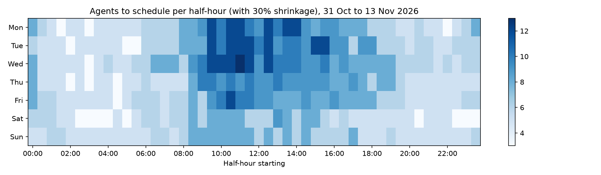

# Contact-center volume forecasting: executive summary

## Overview

New York City's housing agency (HPD) gets about 2,200 requests a day through 311, by phone, online and through the mobile app. This project forecasts daily requests two weeks ahead, splits each day into half-hours and works out how many phone agents each half-hour needs. It uses 2,386,138 requests created between 1 Nov 2023 and 30 Oct 2026.

## Problem

Volume is very seasonal. Summer days bring about 1,300 to 1,800 requests and January days 3,000 to 4,200, and a cold snap can double a day's volume. Planning from the same weekday last week was off by 24.7% on average in the backtest, and by 36% in winter.

## Solution

A SARIMA model with a weekly pattern and a flag for the six holidays that cut volume roughly in half. It was tested by forecasting 14 days ahead from 51 start dates over two years. Each daily forecast is spread over 48 half-hours using the recent intraday pattern, and Erlang C turns the calls in each half-hour into agents.

## Key findings

- The 14-day forecasts are off by 20.8% on average, against 24.7% for repeating last week, and in winter the error drops from 36% to 27.5%.
- The 80% prediction intervals contain the actual on 82% of days, but only 71% in winter.
- For 31 Oct to 13 Nov 2026, with a 5-minute handle time, 80% of calls answered within 20 seconds and 30% shrinkage, weekdays from about 9:30 to 3:30 need 12 agents scheduled in most half-hours, with a peak of 13.
- Every extra minute of handle time adds about 190 agent-hours over two weeks, more than any forecasting choice changes.

## Next steps

- Add a temperature forecast. Cold snaps cause the biggest misses and the model can't see them coming.
- Replace the assumed handle time with the real one from the call center.
- Recheck phone's share of requests every few weeks, since it dropped twice in the last year.
